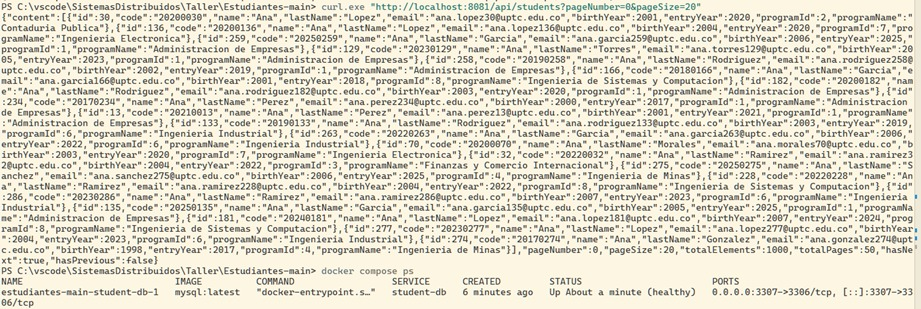
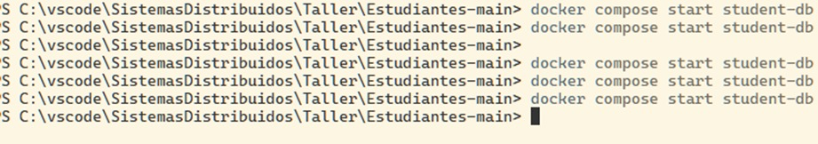
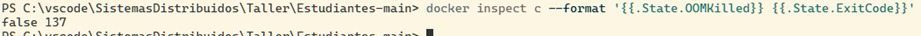

# Taller 1 — Contenedores y Docker Compose
Integrantes: Nicolas Garzon Ballen 202212222, Jeison David Guatibonza Carreño 202212932  
Repositorio: https://github.com/NicolasGarzonBallen/laboratorio2/tree/main/Entregables/TallerContenedores/202212222-202212932
## Parte A
A.1)
Predicción: Bajo las predicciones y lo entendido en clase, el PID que debe mostrar dentro del contenedor es el PID 1, y por fuera sería un número distinto, porque sería un proceso distinto al principal o al original.
También el `docker top`, como lo ve desde el anfitrión, mostraría un número grande, en cambio el otro comando mostraría algo más pequeño por ser el PID 1, ya que solo analiza sus propios procesos.
Y el mecanismo del kernel que lo explicaría sería el namespace (el nombre que sale delante del PID), ya que muestra lo que el kernel está teniendo en cuenta.

Resultados:
- `docker run -d --name web nginx`: la imagen no estaba en local, entonces la descargó y creó el contenedor.

```
Unable to find image 'nginx:latest' locally
c139fe92686d: Pull complete
9f604dae09b2: Pull complete
a670537bed70: Pull complete
d322f1bf41d8: Pull complete
a071113ac575: Pull complete
6fc242d221a6: Pull complete
Digest: sha256:600f7cd45e27aa13e9304c834ab7c1b0ff39df85ee1dcc5087955455d77bc83b
Status: Downloaded newer image for nginx:latest
3752a7c2a3c0c1fc7ce8d6aabfcff121336870959274a8a6a3f07e0ce6e84a2f
```

- `docker top web` (visto desde el anfitrión):

```
UID     PID   PPID  C  STIME  TTY  TIME      CMD
root    763   740   0  04:18  ?    00:00:00
statd   801   763   0  04:18  ?    00:00:00  nginx: worker process
statd   802   763   0  04:18  ?    00:00:00  nginx: worker process
statd   803   763   0  04:18  ?    00:00:00  nginx: worker process
statd   804   763   0  04:18  ?    00:00:00  nginx: worker process
```

Aquí se ve que el UID root tiene el PID 763 (en la salida el comando del master salió vacío), y los demás procesos (801 al 804) son workers con otro PID pero con PPID 763, o sea que son hijos del master.

- `docker exec web ps aux`: aquí hubo un error porque el ejecutable `ps` no existe en la imagen de nginx:

```
OCI runtime exec failed: exec failed: unable to start container process: exec: "ps": executable file not found in $PATH: unknown
```

- `docker exec web cat /proc/1/cmdline`: como alternativa a `ps`, este sí dio resultado:

```
nginx: master process nginx -g daemon off;
```

Estos resultados nos dicen que todo salió bien: el `cat /proc/1/cmdline` muestra que el PID 1 dentro del contenedor es el master de nginx, y el `docker top` lo muestra con el PID 763 desde el anfitrión. Es decir, el PID 1 de adentro y el PID 763 de afuera son el mismo proceso, solo que visto con dos números distintos.
¿En qué se diferencia lo que ve `docker top` de lo que ve el proceso desde adentro?
El `docker top` muestra los PIDs reales del anfitrión (763, 801 al 804), que son números grandes. Desde adentro el contenedor tiene su propia numeración, donde el master es el PID 1 y solo ve sus propios procesos.
¿Qué mecanismo del kernel lo explica?
El namespace de PID: cada contenedor tiene su propio espacio de numeración de procesos, aislado del anfitrión. Controla lo que el proceso ve, no lo que usa (eso lo hacen los cgroups).

A.2)
Predicción: Básicamente, bajo la condición que pone de que cargue 200 MB, si la memoria RAM está limitada y es menor a esa carga de 200 MB, saldría un código en base al desfase o derrame de memoria.

Resultados:
- docker run -d --name limitado --memory=64m --cpus=0.5 nginx: creó el contenedor con el límite de 64 MB de memoria y media CPU.

```
0151889be1aad6725850c9f506599027efa9169347fc35bbf9a39ffd59b79665
```

- docker stats --no-stream (muestra los dos contenedores que teníamos corriendo):

```
CONTAINER ID   NAME       CPU %     MEM USAGE / LIMIT     MEM %     NET I/O        BLOCK I/O     PIDS
0151889be1aa   limitado   0.00%     5.27MiB / 64MiB       8.23%     872B / 126B    0B / 8.19kB   5
3752a7c2a3c0   web        0.00%     4.805MiB / 6.733GiB   0.07%     1.3kB / 126B   0B / 12.3kB   5
```

Aquí se ve que los dos contenedores usan casi lo mismo (alrededor de 5 MiB), pero el límite es distinto: `limitado` tiene 64 MiB y `web`, como no tiene restricción, ve toda la memoria que tiene Docker asignada (6.733 GiB).

- docker inspect limitado --format '{{.HostConfig.Memory}} {{.HostConfig.NanoCpus}}':

```
67108864 500000000
```

Esto confirma los límites que pusimos: 64 MB son 67.108.864 bytes (64 x 1024 x 1024) y 0.5 CPUs son 500.000.000 NanoCpus (1 CPU = 1.000.000.000).

Estos resultados nos dicen que el límite sí quedó aplicado al contenedor `limitado`. Nginx usa solo unos 5 MiB, por eso arrancó sin problema con 64 MiB: el límite solo actúa cuando el proceso intenta pasarse.

¿Qué pasaría si el proceso intentara usar 200 MB?
Como el límite es de 64 MB, el proceso se pasaría de lo permitido. El kernel no lo deja seguir y activa el OOM killer (Out Of Memory), que mata el proceso de inmediato con la señal SIGKILL, sin dejarlo cerrar con calma. Docker lo marcaría como `OOMKilled: true`.

¿Con qué código de salida terminaría?
Con el código 137, que sale de 128 + 9 (el 9 es la señal SIGKILL).

El mecanismo del kernel que lo explica son los cgroups: controlan cuánto usa el proceso (memoria y CPU), a diferencia de los namespaces que controlan lo que ve.

A.3)
Predicción: Según lo que hemos visto en clase y lo que tiene el módulo, debería tener más de 5 capas, porque entre todo lo que tiene debe cargar muchas cosas. Entre las capas más grandes estaría la del JRE, ya que es la que más archivos tiene por la cantidad de librerías que trae. Y 10 contenedores no ocupan 10 veces el tamaño porque las imágenes son de solo lectura, lo que significa una carga mucho menor, ya que cada contenedor solo agrega al inicio una capa de escritura ligera.

Resultados:
- docker pull eclipse-temurin:21-jre: descargó la imagen y se ven 6 capas descargadas (Pull complete).

```
21-jre: Pulling from library/eclipse-temurin
c245b7a1c8de: Pull complete
edafa32f5d9e: Pull complete
fc572c000eb7: Pull complete
f3f25b84a7d7: Pull complete
e63591917c26: Pull complete
dbf780801810: Pull complete
Digest: sha256:f37956012e0cb88400e5b3689aeae2d2d735364c1922ae2225536163b5a99f56
Status: Downloaded newer image for eclipse-temurin:21-jre
docker.io/library/eclipse-temurin:21-jre
```

- docker history eclipse-temurin:21-jre:

```
IMAGE          CREATED      CREATED BY                                      SIZE      COMMENT
f37956012e0c   2 days ago   ENTRYPOINT ["/__cacert_entrypoint.sh"]          0B        buildkit.dockerfile.v0
<missing>      2 days ago   COPY --chmod=755 entrypoint.sh /__cacert_ent…   12.3kB    buildkit.dockerfile.v0
<missing>      2 days ago   RUN /bin/sh -c set -eux;     echo "Verifying…   12.3kB    buildkit.dockerfile.v0
<missing>      2 days ago   RUN /bin/sh -c set -eux;     ARCH="$(dpkg --…   166MB     buildkit.dockerfile.v0
<missing>      2 days ago   ENV JAVA_VERSION=jdk-21.0.12.1+1                0B        buildkit.dockerfile.v0
<missing>      2 days ago   ENV LANG=en_US.UTF-8 LANGUAGE=en_US:en LC_AL…   0B        buildkit.dockerfile.v0
<missing>      2 days ago   ENV PATH=/opt/java/openjdk/bin:/usr/local/sb…   0B        buildkit.dockerfile.v0
<missing>      2 days ago   ENV JAVA_HOME=/opt/java/openjdk                 0B        buildkit.dockerfile.v0
<missing>      3 days ago   umoci raw add-layer --image /home/buildd/roc…   12.3kB    Add rock control metadata
<missing>      3 days ago   umoci config --image /home/buildd/rockcraft-…   0B        Set annotations
<missing>      3 days ago   umoci config --image /home/buildd/rockcraft-…   0B        Set labels
<missing>      3 days ago   umoci config --image /home/buildd/rockcraft-…   0B        Set default PATH for bare-based rock
<missing>      3 days ago   umoci config --image /home/buildd/rockcraft-…   0B        Set default commands
<missing>      3 days ago   umoci config --image /home/buildd/rockcraft-…   0B        Set entrypoint
<missing>      3 days ago   umoci raw add-layer --image /home/buildd/roc…   117MB
```

- docker image ls eclipse-temurin:

```
REPOSITORY        TAG       IMAGE ID       CREATED      SIZE
eclipse-temurin   21-jre    f37956012e0c   2 days ago   456MB
```

Estos resultados nos dicen que la predicción fue correcta. El `docker history` muestra 15 filas en total, pero la mayoría pesan 0B porque son solo metadatos (los `ENV`, `ENTRYPOINT` y los `umoci config`). Las que pesan algo son 5: la de 166MB, la de 117MB y tres de 12.3kB.

¿Cuántas capas tiene?
El `docker history` muestra 15 filas, pero las capas reales son 6 (lo confirmamos más abajo con `docker image inspect`, y coincide con las 6 que descargó el `docker pull`). Es decir, tiene más de 5 capas, como se había predicho.

¿Cuál es la más grande?
La del RUN que instala Java (el que usa `dpkg --...`) con 166MB, que es la del JRE. La segunda más grande es la base del sistema (la última fila, 117MB). Esto coincide con lo que predije.

¿Por qué diez contenedores de esta imagen no ocupan 10 veces su tamaño?
Porque las capas de la imagen son de solo lectura y se comparten entre los contenedores, entonces la imagen se guarda una sola vez en disco. Cada contenedor solo agrega su propia capa delgada de escritura (copy-on-write), que al inicio pesa casi nada. Esto lo vimos con nginx: en `docker system df -v` los contenedores `web` y `limitado` usan la misma imagen (241MB, guardada una sola vez) y cada contenedor ocupa solo 81.9kB de su capa de escritura.

Observación extra: los tamaños no cuadran
Al sumar las capas del `docker history` (166MB + 117MB + 3 de 12.3kB) da cerca de 283MB, pero `docker image ls` muestra 456MB. Para investigarlo ejecutamos dos comandos más:

- docker image inspect eclipse-temurin:21-jre --format '{{.Size}} {{len .RootFS.Layers}}':

```
115393424 6
```

- docker system df -v: la imagen eclipse-temurin aparece con 456MB (SHARED SIZE 0B y UNIQUE SIZE 456.2MB).

Qué se pudo confirmar:
- La imagen tiene 6 capas reales (RootFS.Layers = 6), igual que el `docker pull`. El `docker history` muestra 15 filas porque cuenta también las instrucciones de metadatos de 0B, que no crean capa.
- Nos equivocamos en una suposición: pensábamos que `inspect` iba a dar cerca de 456MB, pero dio 115MB (cercano a la capa de 117MB del history).

Qué no se pudo explicar:
- Tres fuentes dan tres tamaños distintos (115MB en `inspect`, 283MB sumando el history y 456MB en `image ls`). Una posible causa es que cada comando mida algo diferente (tamaño comprimido o propio frente a tamaño descomprimido en disco), pero no lo pudimos comprobar, así que queda como hipótesis sin confirmar.

A.4)
Predicción: En el primer caso los datos no van a estar, por estar de manera efímera en la capa de escritura del pg1, es decir, no existirán. En el segundo caso sí arrojaría un resultado, al no haber ninguna modificación y tener volumen. Y el comando que borraría el volumen sería `docker volume rm pgdata`.

Resultados:

Sin volumen:
- docker run -d --name pg1 -e POSTGRES_PASSWORD=demo postgres:16: la imagen no estaba en local, entonces la descargó y creó el contenedor.
- docker exec -it pg1 psql -U postgres -c "CREATE TABLE prueba(id int); INSERT INTO prueba VALUES (1);": creó la tabla e insertó el dato.

```
CREATE TABLE
INSERT 0 1
```

- docker rm -f pg1, y luego se volvió a crear con el mismo docker run. Al consultar:

```
docker exec -it pg1 psql -U postgres -c "SELECT * FROM prueba;"
ERROR:  relation "prueba" does not exist
LINE 1: SELECT * FROM prueba;
```

La tabla ya no existe: los datos se perdieron al borrar el contenedor.

Con volumen:
- Aquí hubo un error mío al escribir el comando: la primera vez quedó cortado (`-v` sin argumento) y Docker mostró `flag needs an argument: 'v' in -v`. En el segundo intento la ruta quedó incompleta (`-v pgdata:/var/lib/postgresql/`, sin `data`) porque no había entendido bien cómo se escribía. Después usé la ruta completa `pgdata:/var/lib/postgresql/data`.
- docker exec -it pg2 psql ... (CREATE TABLE e INSERT): funcionó.

```
CREATE TABLE
INSERT 0 1
```

- docker rm -f pg2, y se volvió a crear con el mismo volumen:

```
docker run -d --name pg2 -e POSTGRES_PASSWORD=demo -v pgdata:/var/lib/postgresql/data postgres:16
docker exec -it pg2 psql -U postgres -c "SELECT * FROM prueba;"
 id
----
  1
(1 row)
```

El dato sigue ahí aunque el contenedor se borró.

Limpieza: se ejecutó docker rm -f web limitado pg1 pg2. Salió "No such container: pg1" porque pg1 ya se había borrado antes de crear pg2, así que no es un problema. Luego docker volume rm pgdata borró el volumen sin errores.

¿Dónde estaban los datos en el primer caso?
Dentro del almacenamiento del propio contenedor pg1 (su capa de escritura, que es efímera). Al hacer `docker rm -f pg1` esa capa se borró y el nuevo pg1 empezó vacío, por eso dio el error.
¿Y en el segundo?
En el volumen `pgdata`, que Docker guarda aparte del contenedor. Por eso al recrear pg2 con el mismo volumen, los datos seguían.
¿Qué comando borraría el volumen?
`docker volume rm pgdata` (no se puede si hay un contenedor usándolo).
## Parte B
B.1)
Endpoint de salud
Agregamos en el `pom.xml` la dependencia `spring-boot-starter-actuator`:

```xml
<dependency>
  <groupId>org.springframework.boot</groupId>
  <artifactId>spring-boot-starter-actuator</artifactId>
</dependency>
```

Y en el `application.properties` agregamos:

```
management.endpoints.web.exposure.include=health
management.endpoint.health.probes.enabled=true
server.shutdown=graceful
```

Para verificar que funciona se ejecutó `curl.exe http://localhost:8081/actuator/health` (con `curl.exe` porque en PowerShell `curl` es un alias de `Invoke-WebRequest` y no muestra el cuerpo de la respuesta), y respondió con el estado esperado:

```
{"status":"UP","groups":["liveness","readiness"]}
```

El `"status":"UP"` confirma que el módulo está arriba. Los grupos `liveness` y `readiness` aparecen porque activamos `management.endpoint.health.probes.enabled=true`; son las sondas que más adelante usará un orquestador como Kubernetes para saber si el módulo está vivo y si está listo para recibir tráfico.

B.2)
Dockerfile multi-etapa

Se reescribió el `Dockerfile` del módulo con dos etapas:

```dockerfile
# ---- Etapa 1: build ----
FROM maven:3.9-eclipse-temurin-21 AS build
WORKDIR /app
COPY pom.xml .
RUN mvn -q dependency:go-offline
COPY src ./src
RUN mvn -q package -DskipTests

# ---- Etapa 2: runtime ----
FROM eclipse-temurin:21-jre
RUN apt-get update && apt-get install -y --no-install-recommends curl \
 && rm -rf /var/lib/apt/lists/* \
 && useradd -r -u 1001 app
USER app
COPY --from=build /app/target/*.jar /app/app.jar
EXPOSE 8081
ENTRYPOINT ["java","-XX:MaxRAMPercentage=75","-jar","/app/app.jar"]
```

Qué hace cada parte:
- Dos etapas: la primera (`maven`, con JDK) compila el jar; la segunda (`eclipse-temurin:21-jre`) solo corre el jar. La imagen final no lleva Maven, el JDK completo ni el código fuente.
- `COPY pom.xml` y `go-offline` van antes de `COPY src`, para que las dependencias queden en una capa que se reutiliza (caché de build) si solo cambia el código.
- `useradd -r -u 1001 app` y `USER app`: el proceso corre sin root, con el uid 1001.
- `ENTRYPOINT` en forma exec (lista JSON): `java` queda como PID 1 y recibe directamente el SIGTERM al detener el contenedor.
- `-XX:MaxRAMPercentage=75`: la JVM usa hasta el 75 % de la memoria asignada al contenedor.
- `curl` se instala solo para el healthcheck de Compose.

`.dockerignore`:

```
target/
.git/
.env
*.md
.idea/
```

Excluye `target/` y `.git/` (peso innecesario, el jar se compila dentro de la imagen), `.idea/` y `*.md`, y sobre todo `.env`, para que las contraseñas no queden dentro de la imagen.

Pregunta de reflexión: ¿cómo evitarían instalar `curl`?
La instalación de `curl` agranda la imagen y agrega superficie de ataque. Se puede evitar si la comprobación de salud la hace quien orquesta y no la imagen: en Kubernetes las sondas (liveness/readiness) consultan `/actuator/health` por HTTP desde el propio nodo, sin necesitar ningún binario dentro del contenedor. Otra opción es hacer la comprobación desde un contenedor auxiliar que sí tenga `curl`, o usar una herramienta que la imagen ya traiga.

B.3)

Predicción: la guía dice que sin la BD el módulo falla al arrancar, así que esperábamos ver un error de conexión a MySQL en los logs.

Resultados:
- `docker build -t estudiantes:1.0 .`: construyó la imagen. Todos los pasos salieron `CACHED` porque ya se habían construido antes con `docker compose up --build` (el primer build tardó unos 12 minutos por descargar las imágenes base y las dependencias de Maven; este tardó 4 s).
- `docker image ls estudiantes`:

```
REPOSITORY    TAG       IMAGE ID       CREATED          SIZE
estudiantes   1.0       799f7bfea29e   21 minutes ago   566MB
```

La imagen pesa 566MB. La base `eclipse-temurin:21-jre` ya pesaba 456MB (Parte A.3); el resto corresponde al jar de la aplicación y a `curl`.

- `docker run -d --name est -p 8081:8081 estudiantes:1.0`: falló antes de arrancar:

```
docker: Error response from daemon: failed to set up container networking: driver failed programming external connectivity ... port is already allocated
```

El puerto 8081 del anfitrión ya lo tenía publicado el contenedor `student-service-student-service-1` del compose, que seguía corriendo. Docker alcanzó a crear el contenedor `est` (quedó en estado `Created`).

- Segundo intento con `-p 8082:8081`: falló por otro motivo:

```
docker: Error response from daemon: Conflict. The container name "/est" is already in use by container "4388dd662be0..."
```

El nombre `est` seguía ocupado por el contenedor que quedó del intento anterior. Aprendizaje: un `docker run` fallido por red puede dejar el contenedor creado, y hay que borrarlo antes de reutilizar el nombre.

- `docker rm est` y de nuevo `docker run -d --name est -p 8082:8081 estudiantes:1.0`: esta vez el contenedor se creó y arrancó. Se usó el puerto 8082 del anfitrión (el interno sigue siendo 8081), porque el 8081 lo ocupa el compose.

- `docker ps -a --filter name=est`:

```
CONTAINER ID   IMAGE             COMMAND                  CREATED         STATUS                     PORTS     NAMES
ca62ac0c3e95   estudiantes:1.0   "java -XX:MaxRAMPerc…"   5 minutes ago   Exited (1) 5 minutes ago             est
```

- `docker logs est`: el contenedor se detuvo al arrancar. El error final fue:

```
Caused by: java.lang.IllegalArgumentException: Could not resolve placeholder 'SERVER_PORT' in value "${SERVER_PORT}"
```

Estos resultados nos dicen que el módulo sí falla al arrancar, como decía la guía, pero **por otra causa distinta a la que predijimos**: no llegó a intentar conectarse a la BD. `application.properties` define `server.port=${SERVER_PORT}` y los datos de conexión con `${DB_HOST}`, `${DB_NAME}`, etc., cuyos valores vienen del archivo `.env`. Como `.dockerignore` excluye `.env`, la imagen no lo trae, y el contenedor creado con un `docker run` simple no recibe ninguna de esas variables. Spring no puede resolver el primer placeholder (`SERVER_PORT`, que Actuator lee al arrancar) y se detiene antes de llegar a la BD.

Esto confirma dos cosas:
1. El `.dockerignore` funciona: `.env`, con las contraseñas, no quedó dentro de la imagen.
2. La configuración debe entrar al contenedor desde afuera. Eso es lo que resuelve Docker Compose con `env_file` y `environment` (Parte C).

Nos equivocamos en cuál sería el primer error: esperábamos un fallo de conexión a la BD y el real fue de configuración, anterior a la conexión.

B.4)
Cuatro verificaciones obligatorias

Se hicieron sobre el contenedor del compose (`student-service-student-service-1`), no sobre `est` (ese ya se había borrado en B.3). Primero con el `ENTRYPOINT` en forma exec (el Dockerfile definitivo) y después con la forma shell, como pide la guía.

Resultados (forma exec):

- `docker exec est id`: dio `Error response from daemon: No such container: est`, porque `est` era el contenedor fallido de B.3 y ya se había borrado. Se usó el servicio del compose:

```
docker compose exec student-service id
uid=1001(app) gid=999(app) groups=999(app)
```

El proceso no corre como root: es el usuario `app` con el uid 1001 que creó el Dockerfile. El gid 999 es el grupo de sistema que `useradd -r` creó automáticamente.

- PID 1. La imagen no trae `ps` (igual que nginx en A.1), así que se leyó `/proc/1/cmdline`:

```
docker compose exec student-service cat /proc/1/cmdline
java-XX:MaxRAMPercentage=75-jar/app/app.jar
```

El PID 1 es `java` directamente. Los argumentos salen pegados porque `/proc/1/cmdline` los separa con caracteres nulos (no son espacios).

- Tiempo de `stop`. `time docker stop est` no funcionó: en PowerShell `time` no existe (además `est` ya no existía). Se usó `Measure-Command`:

```
Measure-Command { docker compose stop student-service }
 ✔ Container student-service-student-service-1  Stopped   1.0s
TotalSeconds      : 1,5751214
```

Se detuvo en 1,6 s, es decir, mucho menos que el límite de 10 s de Docker.

- Código de salida:

```
docker inspect student-service-student-service-1 --format '{{.State.ExitCode}}'
143
```

143 = 128 + 15 (señal SIGTERM). Significa que el módulo recibió SIGTERM, lo manejó y se cerró de forma ordenada (esto lo permite `server.shutdown=graceful`, que se agregó en B.1).

Resultados (ENTRYPOINT en forma shell):

Se cambió la última línea del Dockerfile a `ENTRYPOINT java -XX:MaxRAMPercentage=75 -jar /app/app.jar`, se reconstruyó con `docker compose up -d --build` y se repitieron las mediciones. (En el build todos los pasos salieron `CACHED`: cambiar el `ENTRYPOINT` solo modifica la configuración de la imagen, no crea ni cambia capas de archivos.)

```
docker compose exec student-service cat /proc/1/cmdline
/bin/sh-cjava -XX:MaxRAMPercentage=75 -jar /app/app.jar

Measure-Command { docker compose stop student-service }
 ✔ Container student-service-student-service-1  Stopped   10.6s
TotalSeconds      : 10,9982332

docker inspect student-service-student-service-1 --format '{{.State.ExitCode}}'
137
```

Tabla comparativa:

| | Forma exec (lista JSON) | Forma shell |
|---|---|---|
| PID 1 | `java` | `/bin/sh -c java ...` |
| Tiempo de `stop` | 1,6 s | 11,0 s |
| Código de salida | 143 (SIGTERM, cierre ordenado) | 137 (SIGKILL, muerte forzada) |

Después de la prueba se volvió a la forma exec en el Dockerfile.

¿El PID 1 es `java`? ¿Por qué importa?
En forma exec sí. Importa porque el PID 1 es el proceso que recibe las señales que Docker manda al contenedor (SIGTERM al hacer `docker stop`). Si el PID 1 es `java`, la aplicación recibe SIGTERM directamente y puede cerrar sus conexiones y terminar ordenadamente.

¿`docker stop` tardó cerca de 10 s? Si sí, ¿qué está mal?
En forma exec no (1,6 s). En forma shell sí (11 s). Lo que está mal es la forma shell: Docker ejecuta `/bin/sh -c "java ..."`, así que el PID 1 es `sh` y `java` queda como proceso hijo. `sh` no reenvía el SIGTERM a `java`, entonces la aplicación nunca se entera de que debe cerrarse. Docker espera su plazo de 10 s y, al vencer, manda SIGKILL, que mata el contenedor a la fuerza. Por eso el tiempo (~10 s) y el código 137 (128 + 9).

Diferencia anotada entre forma exec y forma shell: el `stop` pasó de 1,6 s a 11,0 s (unas 7 veces más lento) y el cierre pasó de ordenado (143) a forzado (137). En producción esto significaría perder peticiones en curso o dejar transacciones a medias cada vez que se reinicie el contenedor.

Una duda que quedaba: algunos `sh` optimizan y ejecutan el comando directamente, sin dejar a `sh` como PID 1. En esta imagen no pasó: `/proc/1/cmdline` mostró `/bin/sh -c java ...`, por lo que la diferencia sí se produjo.

B.5)
Caché de build

Se midió cuánto tarda reconstruir la imagen después de un cambio trivial en `StudentServiceApplication.java` (un comentario), con dos órdenes distintos de `COPY` en el Dockerfile. El tiempo se midió con `$t = Get-Date; docker build --progress=plain -t ... . ; ((Get-Date) - $t).TotalSeconds` (la salida con `--progress=plain` muestra todos los pasos y cuáles dicen `CACHED`).

Build 1: orden correcto (`COPY pom.xml` → `go-offline` → `COPY src` → `package`), con el comentario `// prueba 1` agregado:

```
docker build --progress=plain -t estudiantes:1.1 .
[build 2/6] WORKDIR /app                       CACHED
[build 3/6] COPY pom.xml .                     CACHED
[build 4/6] RUN mvn -q dependency:go-offline   CACHED
[build 5/6] COPY src ./src                     DONE 0.2s
[build 6/6] RUN mvn -q package -DskipTests     DONE 26.7s
[stage-1 2/3] RUN apt-get ... curl ...         CACHED
[stage-1 3/3] COPY --from=build ...            DONE 0.2s
Tiempo total: 38,07 s
```

Solo se rehicieron los pasos que dependen del código (`COPY src` y `package`). La descarga de dependencias (`go-offline`), que es la parte lenta, se reutilizó de la caché.

Build 2: orden invertido. Se movió `COPY src ./src` antes de `RUN mvn -q dependency:go-offline`:

```
COPY pom.xml .
COPY src ./src
RUN mvn -q dependency:go-offline
RUN mvn -q package -DskipTests
```

Con el nuevo orden y el comentario cambiado a `// prueba 2`, se reconstruyó:

```
docker build -t estudiantes:1.2 .
[build 2/6] WORKDIR /app                       CACHED
[build 3/6] COPY pom.xml .                     CACHED
[build 4/6] COPY src ./src                     0.3s
[build 5/6] RUN mvn -q dependency:go-offline   272.2s
Tiempo total: 329,3 s
```

Aquí `go-offline` volvió a descargar todas las dependencias: 272 s. (La salida resumida de Docker solo muestra algunas líneas y no mostró el paso `package`, pero también se rehizo, porque depende de la capa anterior que cambió.)

Nota: este build combinó dos cambios a la vez (el orden del Dockerfile y el comentario del código), que es el procedimiento que pide la guía. Cualquiera de los dos, por separado, ya habría invalidado `go-offline`, porque ahora esa capa viene después de `COPY src`.

Repeticiones sin cambiar nada (comprobación de que la caché funciona):

```
docker build --progress=plain -t estudiantes:1.1 .   → todos los pasos CACHED, 4,25 s
docker build --progress=plain -t estudiantes:1.2 .   → todos los pasos CACHED, 3,41 s
```

Observación sobre un build intermedio: el primer `docker build -t estudiantes:1.2 .` (3,7 s, todo `CACHED`) se corrió antes de invertir el orden: sus pasos aparecen numerados con `COPY src` en el 5/6 y `package` en el 6/6, que es el orden original. Como además no había cambios en el código, no mide nada.

Tabla comparativa:

| | Orden correcto (build 1.1) | Orden invertido (build 1.2) |
|---|---|---|
| Tiempo tras un cambio en el código | 38,1 s | 329,3 s |
| `go-offline` (descarga de dependencias) | `CACHED` | se rehízo: 272,2 s |
| Pasos rehechos | `COPY src` (0,2 s) y `package` (26,7 s) | `COPY src` (0,3 s), `go-offline` (272,2 s) y `package` |
| Sin cambios en el código | 3,4 a 4,3 s, todo `CACHED` | 3,4 a 4,3 s, todo `CACHED` |

El build con el orden invertido tardó unas 8,6 veces más (329,3 s contra 38,1 s) para el mismo cambio trivial.

¿Cuánto tardó cada build y qué capas se reutilizaron?
Con el orden correcto, tras cambiar el código el build tardó 38,1 s y se reutilizaron la capa de `pom.xml` y la de `go-offline`; solo se rehicieron `COPY src` y `package` (compilar en 26,7 s). Con el orden invertido tardó 329,3 s: solo se reutilizaron `WORKDIR` y `COPY pom.xml`, y `go-offline` se tuvo que ejecutar de nuevo (272,2 s). Sin ningún cambio, cualquier build tarda entre 3 y 4 s porque todos los pasos salen de la caché.

¿Por qué se copia `pom.xml` antes que `src`?
Porque Docker reutiliza una capa solo si ella y todas las anteriores no cambiaron; en cuanto una capa cambia, se rehacen todas las que vienen después. El `pom.xml` cambia pocas veces y el código fuente cambia todo el tiempo. Si `go-offline` va justo después de `COPY pom.xml` y antes de `COPY src`, las dependencias quedan en una capa que sobrevive a los cambios de código. Si `COPY src` va antes, cualquier cambio en el código invalida también la descarga de dependencias, y cada build vuelve a bajar todo.

Al terminar se restauró el Dockerfile al orden correcto y se quitaron los comentarios de prueba del `.java`.

## Parte C
Los experimentos de las Partes C y D los ejecutó Jeison en su equipo (carpeta `Estudiantes-main`, con el compose original); C.1 se repitió además con el módulo corregido en el equipo de Nicolas. Donde algo no se pudo repetir o verificar, la sección lo indica con la palabra "Limitación".

C.1) Levantar y observar

Predicción: `docker compose up -d --build` debería construir la imagen del módulo, crear el volumen de la BD y arrancar los contenedores.

Comandos:
```
docker compose up -d --build
docker compose ps
docker compose logs -f student-service
curl.exe http://localhost:8081/actuator/health
```

Observado (equipo de Jeison, módulo sin Actuator):
- Build: la segunda ejecución tardó unos segundos frente a más de 2 minutos de la primera, porque Docker reutilizó las capas en caché (`CACHED`) de Maven (ni el código ni el `pom.xml` habían cambiado). Se generó la imagen `estudiantes-main-student-service:latest`, multi-etapa, con Java 21 JRE en la etapa final.
- Orden de arranque: primero `student-db`, que esperó a quedar `healthy` (healthcheck con `mysqladmin ping`), y después `student-service`.
- `docker compose ps`: `student-db` en `Up 5 minutes (healthy)`, con el puerto 3307 del anfitrión mapeado al 3306. `student-service` en `Up 4 minutes`, ejecutando `java -jar app.jar` en el puerto 8081.
- Logs: Spring Boot 3.3.2 sobre Java 21; arrancó Tomcat en el 8081 y HikariCP conectó con MySQL (`HikariPool-1 - Start completed`). Terminó de arrancar en unos 13,9 s.
- `/actuator/health`: respondió **404 Not Found**.

Explicación del 404: el contenedor corre, pero la aplicación no expone el endpoint porque faltaba la dependencia `spring-boot-starter-actuator` en el `pom.xml` y las propiedades `management.*` en `application.properties`. El healthcheck del compose consulta justo ese endpoint, y por eso `student-service` aparecía solo como `Up` y no como `healthy`.

Repetido con el módulo corregido (Actuator, `server.shutdown=graceful`, healthcheck en el compose; equipo de Nicolas):

```
docker compose up -d --build
 ✔ Container student-service-student-db-1       Healthy
 ✔ Container student-service-student-service-1  Started

docker compose ps
NAME                                IMAGE             SERVICE           STATUS                        PORTS
student-service-student-db-1        mysql:latest      student-db        Up About a minute (healthy)   3306/tcp, 33060/tcp
student-service-student-service-1   estudiantes:1.0   student-service   Up About a minute (healthy)   0.0.0.0:8081->8081/tcp, [::]:8081->8081/tcp

curl http://localhost:8081/actuator/health   →   StatusCode 200
```

Ahora ambos servicios quedan `healthy`, y la BD ya no publica ningún puerto al anfitrión (solo `3306/tcp` interno). El cuerpo de la respuesta de salud se mostró en B.1 (`{"status":"UP",...}`).

Limitación: con el módulo corregido no se probó una operación real de la API (crear y listar un estudiante); solo se verificó el estado `healthy` y la respuesta de `/actuator/health`.

C.2.1) ¿La BD es accesible desde el laptop?

Predicción:

No se registró una predicción previa para este experimento, y no se rellena después de ver el resultado.

Comando:
```
Test-NetConnection localhost -Port 3307
```

Observado (compose original con `ports: ["3307:3306"]`): `TcpTestSucceeded : True`. El puerto está abierto y responde.

Explicación: al publicar el puerto, Docker crea un puente entre el anfitrión y el contenedor aislado, de modo que cualquier cliente del equipo puede conectarse a MySQL por `localhost:3307`.

Riesgo de publicar el puerto de una BD: la expone fuera de la red privada. Cualquier equipo con acceso a la máquina anfitriona (la red local o internet, según el firewall) puede intentar fuerza bruta sobre las credenciales o explotar vulnerabilidades del motor. En una arquitectura segura la BD queda solo en la red privada interna (`back`) y es accesible únicamente desde el módulo.

Limitación: solo se probó la fase con el puerto publicado. Con el compose corregido la BD ya no publica ningún puerto (en `docker compose ps` solo aparece `3306/tcp`, sin mapeo al anfitrión), por lo que no hay conexión desde el anfitrión salvo que se agregue `ports`; no se repitió la prueba con `Test-NetConnection` en la fase sin puerto.

C.2.2) El error de `localhost`

Predicción: el contenedor `student-service` fallará al conectarse a la BD y no logrará iniciar.

Cambio: `DB_HOST=localhost` en el servicio `student-service`, seguido de `docker compose up -d` y revisión de logs.

Observado: la aplicación arrancó, pero al inicializar JPA y abrir una conexión con HikariCP lanzó `Communications link failure` con `java.net.ConnectException: Connection refused`. El contexto de Spring falló (`Application run failed`), el servicio se detuvo y, por `restart: unless-stopped`, entró en un ciclo de reinicios.

Explicación: dentro de un contenedor `localhost` es el propio contenedor, por el aislamiento de red (namespace). El módulo buscó MySQL en su propio espacio de red, donde nada escucha en el 3306. Para comunicarse dentro de la red de Compose se usa el nombre del servicio (`student-db`), que el DNS interno de Docker resuelve a la IP del contenedor de la BD. Se restauró `DB_HOST=student-db` al terminar.

Limitación: no se conserva captura de `docker compose ps` con el estado `Restarting`.

C.2.3) DNS interno

Predicción:

No se registró una predicción previa para este experimento, y no se rellena después de ver el resultado.

Comando ejecutado:
```
docker exec estudiantes-main-student-db-1 getent hosts student-db
```

Observado: `172.18.0.2` asociada al nombre `student-db`.

Explicación: Docker incluye un servidor DNS interno para las redes definidas por el usuario. Traduce el nombre lógico del servicio a la IP actual del contenedor dentro de la subred. Por eso los módulos no dependen de IPs fijas, que cambian cuando se recrea un contenedor.

Limitación: el comando se ejecutó dentro del contenedor de la BD, que se resuelve a sí mismo; el experimento pedía ejecutarlo desde el módulo (`docker compose exec student-service getent hosts student-db`). Tampoco se comprobó qué pasa con la IP al recrear la BD (`docker compose up -d --force-recreate student-db`): que la IP cambie al recrear el contenedor es una explicación teórica, no una observación.

C.3) Persistencia real

Predicción:

No se registró una predicción previa para este experimento, y no se rellena después de ver el resultado.

`docker compose down`: detuvo y eliminó los contenedores y la red del proyecto (`estudiantes-main_default`), pero conserva los volúmenes con nombre. El volumen `student_db_data` sigue existiendo.

`docker compose up -d`: recreó la red y el contenedor de la BD montando el volumen existente. El arranque del módulo se interrumpió con el mensaje `ports are not available`: el puerto 8081 del anfitrión ya estaba ocupado.

Explicación del error: dos procesos no pueden escuchar a la vez en la misma dirección y puerto. Como el `down` ya había eliminado los contenedores de este proyecto, el ocupante del 8081 era otro proceso del anfitrión (por ejemplo el módulo ejecutándose desde el IDE o con Maven).

`docker compose down -v`: eliminó contenedores, red y el volumen `estudiantes-main_student_db_data`, es decir, los datos de MySQL, de forma irreversible.

| Comando | Contenedores y red | Volúmenes (datos) | Cuándo usarlo |
|---|---|---|---|
| `docker compose down` | Se eliminan | Se conservan | Apagar el entorno sin perder datos (fin de la jornada, cambiar configuración) |
| `docker compose down -v` | Se eliminan | Se eliminan | En desarrollo, para reiniciar desde cero con tablas limpias; en producción, prácticamente nunca |

Limitación: esta sección no demuestra la persistencia con datos, porque no se anotó `totalElements` antes y después de `down` y de `down -v`. Lo observado es el comportamiento de contenedores, red y volumen descrito arriba.

C.4) Orden de arranque

Predicción:

No se registró una predicción previa para este experimento, y no se rellena después de ver el resultado.

Pasos: `docker compose down -v`; quitar el bloque `depends_on` de `student-service`; `docker compose up -d`; revisar `docker compose logs student-service` y `docker compose ps`.

Observado: el módulo arrancó de inmediato. Al inicializar el pool de HikariCP lanzó `Communications link failure` y `Connection refused`; el contexto de Spring falló, Tomcat se detuvo y el contenedor se cayó.

Explicación: sin `depends_on`, Compose inicia los contenedores casi a la vez. MySQL necesita varios segundos (más aún con el volumen vacío, porque inicializa la base) para abrir su puerto y aceptar conexiones, mientras que la JVM llega al punto de conectarse antes. El módulo encuentra el puerto cerrado y falla.

¿Por qué `depends_on` simple no basta? Solo garantiza el orden de arranque (que el contenedor de la BD haya sido iniciado), no que el servicio dentro esté listo. Con `condition: service_healthy`, Compose espera a que el healthcheck de la BD pase antes de iniciar el módulo. Se restauró el bloque `depends_on` al terminar.


## Parte D
Resumen:

| # | Acción | Predicción | Observado |
|---|---|---|---|
| D1 | `docker compose stop student-db` y llamar a la API | Error HTTP 500 o timeout | 200 OK con el listado (equivocación, ver D1) |
| D2 | `docker compose start student-db` | Se recupera sola | Volvió a responder (ver D2) |
| D3 | `docker kill` | Depende de la política de reinicio | `RestartCount` = 0 (ver D3) |
| D4 | `mem_limit: 128m` | No arranca o muere por OOM | `false 137` (ver D4, resultado dudoso) |
| D5 | Quitar `restart` y repetir D3 | No se reinicia | `Exited`, nadie lo levanta |

D.1) BD detenida

Comandos:
```
docker compose stop student-db
curl.exe "http://localhost:8081/api/students?pageNumber=0&pageSize=20"
docker compose ps
docker compose logs student-service
```

Predicción: la API devolvería HTTP 500 o un fallo por timeout, porque al detener la BD se cierra su socket y cualquier consulta debería fallar al no poder abrir una conexión TCP con MySQL.

Observado: la API respondió 200 OK con el listado de estudiantes (`totalElements: 1000`, `totalPages: 50`), sin errores en la respuesta.



Equivocación: la predicción fue incorrecta. Con la BD detenida lo normal es que HikariCP no consiga una conexión y devuelva un error tras su tiempo de espera (30 s por defecto).

El módulo no tiene ninguna caché configurada (no hay `@Cacheable` ni caché de segundo nivel de Hibernate), así que una consulta paginada necesita la BD. Un dato de la propia captura ayuda: el `docker compose ps` que aparece en ella lista **solo** `student-db`, no hay ningún contenedor `student-service`. Es decir, el 200 no lo dio un contenedor de este compose, sino probablemente otro proceso del anfitrión (por ejemplo el módulo corriendo desde el IDE o Maven en el 8081, el mismo que bloqueó el puerto en C.3).

Limitación: no se repitió D1 con el contenedor `student-service` confirmado en ejecución; por eso no se puede afirmar qué respondió realmente la API con la BD detenida, y los resultados de D.1 y D.2 deben tomarse con esa reserva. Tampoco se consultó `/actuator/health` con la BD detenida.

Mejoras para la resiliencia:
- Configurar tiempos límite explícitos en HikariCP (`connection-timeout`, `validation-timeout`) para que los hilos de Tomcat no se queden bloqueados.
- Incorporar reintentos y un circuit breaker (por ejemplo Resilience4j) para fallar rápido y devolver un mensaje claro de degradación del servicio.

D.2) Recuperación

Comando: `docker compose start student-db`, y repetir la llamada a la API cada pocos segundos hasta la primera respuesta correcta.

Predicción: el módulo se recuperará solo, sin reiniciarse, porque HikariCP detecta que las conexiones están muertas y crea otras cuando MySQL vuelve a aceptar conexiones.

Observado: se ejecutó `docker compose start student-db` (varias veces, como muestra la captura) y al repetir el `curl` el servicio volvió a responder con normalidad en poco tiempo, sin reiniciar `student-service`.



Explicación: `start` reactiva el mismo contenedor, pero MySQL necesita unos segundos para abrir sockets y aceptar autenticaciones. El pool de HikariCP descarta las conexiones rotas (las valida antes de entregarlas) y abre nuevas bajo demanda en cuanto el puerto vuelve a estar disponible.

Limitación: no se midió el tiempo de recuperación (segundos entre `start` y la primera respuesta correcta), y como depende de D.1 tiene la misma reserva.

D.3) Matar el contenedor

Comandos:
```
docker compose ps
docker kill <contenedor>
docker inspect <contenedor> --format '{{.RestartCount}}'
```

Predicción: el contenedor se detendría al instante y el contador de reinicios dependería de la política `restart` del compose.

Observado: se ejecutó `docker kill estudiantes-main-student-db-1`. El contenedor se detuvo de inmediato y `RestartCount` fue 0.


Equivocación en la explicación: en un primer momento atribuimos el 0 a que Docker trata `docker kill` como una intervención administrativa intencional. Eso no es correcto: una política `unless-stopped` o `always` sí reinicia un contenedor terminado con `docker kill`; solo se detiene el reinicio cuando el contenedor se para con `docker stop`. El 0 se explica porque el compose original no tenía `restart` en `student-db`, es decir, regía la política por defecto (`no`).

Sobre SIGKILL: a diferencia de SIGTERM, no permite un cierre ordenado ni vaciar búferes; en una BD real puede obligar a un crash recovery al volver a iniciar.

Limitación: el experimento pedía matar el módulo (`student-service`) y se mató la BD. La conclusión sobre la política `restart` se apoya en que el compose original no la tenía en `student-db`; no se comprobó con el módulo y `restart: unless-stopped` activo.

D.4) Límite de memoria

Cambio: `mem_limit: 128m` en `student-service`, seguido de `docker compose up -d`.

Comando de inspección:
```
docker inspect c --format '{{.State.OOMKilled}} {{.State.ExitCode}}'
```

Predicción: el contenedor fallaría al arrancar o sería terminado por el kernel por falta de memoria, ya que una aplicación Spring Boot con Java 21 necesita más que 128 MB para cargar clases, metaspace, hilos y heap.

Observado: `false 137`.



Interpretación posible: el código 137 equivale a 128 + 9, es decir, el proceso recibió SIGKILL; `OOMKilled=false` indica que el flag del kernel no quedó marcado. Una excepción `OutOfMemoryError` de la JVM suele terminar con código 1, no con 137. Con `-XX:MaxRAMPercentage=75` el heap máximo sería de unos 96 MB, pero la JVM usa además memoria fuera del heap (metaspace, pilas de hilos, código JIT, buffers nativos) que cuenta contra el mismo límite del cgroup.

Advertencia sobre este resultado: el comando usó `docker inspect c`, que apunta al contenedor cuyo ID empieza por `c`. En la captura de Docker Desktop (D.3), el único contenedor del proyecto es `student-db-1` con ID `c03ce7ea34e6`. Además, `false 137` es justo lo que deja el `docker kill` de D.3 sobre la BD (SIGKILL, sin OOM). Por lo tanto es muy probable que este resultado sea el de la BD después de D.3 y no el del módulo con `mem_limit: 128m`.

Limitación: D.4 no se repitió sobre el contenedor del módulo, por lo que el resultado no es concluyente y no se determinó el valor mínimo de memoria con el que arranca `student-service`.

D.5) Sin política de reinicio

Cambio: se quitó `restart: unless-stopped` de `student-service`, `docker compose up -d` (con memoria normal), `docker kill` y `docker compose ps -a`.

Predicción: el contenedor no se reiniciaría.

Observado: el contenedor pasa a `Exited` y nadie lo levanta; permanece caído de forma indefinida.

Explicación: sin la propiedad `restart`, Docker aplica la política por defecto, `no`. Con una política activa (`unless-stopped`, `always`, `on-failure`), el motor actúa como supervisor: detecta que el proceso terminó de forma anómala y lo reinicia. Sin ella hace falta intervención manual (`docker compose up -d`). Esa es la diferencia con D.3.

Limitación: no se anotó el código de salida exacto ni el `RestartCount` de este experimento y no hay captura; la observación se basa en el comportamiento descrito.

Preguntas de la Parte D

- ¿Qué diferencia hay entre un contenedor `running` y uno `healthy`?
`running` solo significa que el proceso principal del contenedor está vivo. `healthy` significa que además pasó el healthcheck definido en el compose: en el módulo, que `/actuator/health` responda bien, y en la BD, que `mysqladmin ping` conteste. Un contenedor puede estar `running` y todavía no estar listo (por ejemplo mientras arranca la JVM) o estar colgado sin atender peticiones; el estado `healthy` permite que Compose espere con `service_healthy` y que se detecte ese problema.
- D1: ¿se recupera el módulo sin reiniciarlo? ¿Cómo lo mejorarían?

Sin respuesta confirmada: depende de D.1 y D.2, que no se pudieron verificar con el contenedor del módulo. Lo esperable, por el comportamiento de HikariCP (descarta las conexiones rotas y abre nuevas), es que el módulo se recupere sin reiniciarse una vez que MySQL vuelve a aceptar conexiones. Mejoras: tiempos límite explícitos en el pool, reintentos y circuit breaker (ver D.1).
- D4: ¿cuál es el valor mínimo de memoria con el que arranca el módulo y qué relación tiene con `-XX:MaxRAMPercentage`?

Sin valor medido: no se determinó el mínimo. Relación con `-XX:MaxRAMPercentage=75`: el heap máximo es el 75 % del límite del contenedor, y el 25 % restante tiene que alcanzar para metaspace, hilos y buffers nativos; si el límite es muy bajo, esa parte no alcanza aunque el heap sí.

## Retos E logrados

Ninguno.

## Estado final

Estado del módulo al terminar (equipo de Nicolas), con el compose restaurado: la BD sin `ports`, `depends_on` con `condition: service_healthy`, `restart: unless-stopped` y sin `mem_limit`.

```
docker compose ps
NAME                                IMAGE             SERVICE           STATUS                       PORTS
student-service-student-db-1        mysql:latest      student-db        Up About an hour (healthy)   3306/tcp, 33060/tcp
student-service-student-service-1   estudiantes:1.0   student-service   Up 11 minutes (healthy)      0.0.0.0:8081->8081/tcp, [::]:8081->8081/tcp

curl.exe http://localhost:8081/actuator/health
{"status":"UP","groups":["liveness","readiness"]}
```

## Respuestas personales
Nicolas Garzon:

1. ¿Qué dos mecanismos del kernel hacen que un proceso sea "un contenedor"? ¿Cuál limita lo que ve y cuál lo que usa?
Los namespaces y los cgroups. Los namespaces limitan lo que el proceso ve: tiene su propia numeración de procesos (en A.1 nginx era el PID 1 adentro y el 763 afuera), su propia red y su propio sistema de archivos. Los cgroups limitan lo que usa: la memoria y la CPU (en A.2 el contenedor `limitado` quedó con 64 MiB y 0.5 CPUs, y si se pasa de ahí el kernel lo mata con código 137).

2. ¿Por qué un contenedor arranca más rápido que una VM?
Porque el contenedor no tiene que arrancar un sistema operativo completo. Comparte el kernel del anfitrión y lo único que hace es lanzar un proceso aislado con namespaces y cgroups. La VM tiene que levantar su propio kernel y su propio sistema, reservar memoria para todo eso, y recién ahí arrancar la aplicación.

3. Si cinco contenedores usan la misma imagen, ¿cuántas veces se guarda la base en disco? ¿Por qué?
Una sola vez. Las capas de la imagen son de solo lectura y se comparten entre todos los contenedores. Cada contenedor solo agrega encima su propia capa delgada de escritura (copy-on-write), que al inicio pesa casi nada. Esto lo vimos en A.3 con `docker system df -v`: `web` y `limitado` usaban la misma imagen y cada uno ocupaba solo 81.9kB propios.

4. ¿Por qué se copia `pom.xml` antes que `src` en el Dockerfile?
Por la caché de capas: Docker reutiliza una capa si ella y todas las anteriores no cambiaron, y en cuanto una cambia rehace todas las que siguen. El `pom.xml` casi no cambia y el código cambia todo el tiempo. Copiando primero el `pom.xml` y bajando las dependencias en ese momento, esa capa queda guardada y solo se recompila el código. En B.5 se vio: con el orden correcto el build tardó 38,1 s y con el invertido 329,3 s, porque tuvo que descargar otra vez las dependencias (272,2 s).

5. ¿Qué resuelve el build multi-etapa y qué dejaría de pasar si no lo usaran?
Separa compilar de ejecutar. La primera etapa tiene Maven y el JDK completo para generar el jar, y la segunda solo tiene el JRE y el jar. Si no se usara, la imagen final cargaría con Maven, el JDK, el código fuente y la caché de dependencias: sería mucho más grande, tardaría más en descargarse y tendría más cosas que pueden tener vulnerabilidades. Además, tocaría compilar el jar afuera, en la máquina de cada quien, y la imagen dependería de lo que tenga instalado cada computador.

6. Su módulo tarda 10 s en detenerse. Den dos posibles causas.
La primera, que el `ENTRYPOINT` esté en forma shell: el PID 1 es `sh`, que no le reenvía el SIGTERM a `java`, entonces Docker espera sus 10 s y manda SIGKILL. Esto fue lo que pasó en B.4 (11 s y código 137, contra 1,6 s y código 143 en forma exec). La segunda, que la aplicación sí reciba el SIGTERM pero no cierre a tiempo, por ejemplo porque tiene peticiones en curso con el `server.shutdown=graceful` o conexiones que no libera, y Docker la termine a la fuerza al vencer el plazo.

7. ¿Por qué `localhost` no funciona para llegar a la BD dentro de Compose?
Porque dentro de un contenedor `localhost` es el propio contenedor, no el anfitrión ni los demás. La app busca MySQL en sí misma y ahí no hay ninguno, entonces da `Connection refused`. En Compose cada servicio es un contenedor distinto en la red `back`, y se llegan por el nombre del servicio (en nuestro caso `student-db`), que el DNS interno de Docker resuelve a la IP del contenedor de la base de datos.

8. ¿Qué diferencia hay entre `depends_on` simple y con `service_healthy`?
El `depends_on` simple solo espera a que el contenedor de la BD haya arrancado (esté en estado running), pero eso no significa que MySQL ya esté listo para recibir conexiones, porque tarda unos segundos en inicializar. Con `condition: service_healthy` Compose espera a que el healthcheck de la BD (`mysqladmin ping`) dé OK, o sea, a que de verdad acepte conexiones, y solo ahí arranca el módulo. Sin eso el módulo puede arrancar antes y fallar al conectarse.

9. ¿Qué pasa con los datos al ejecutar `docker compose down`? ¿Y con `down -v`?
Con `docker compose down` se borran los contenedores y la red, pero los volúmenes se conservan, entonces los datos de la BD siguen ahí al volver a levantar con `up`. Con `docker compose down -v` se borran también los volúmenes, y los datos se pierden: la BD arranca vacía. El primero se usa para apagar y volver a prender normalmente, y el segundo cuando se quiere empezar desde cero.

10. Den dos razones por las que no ejecutarían la BD de producción en un contenedor.
Una, los datos son lo más delicado del sistema y un contenedor es efímero: si se borra el contenedor o el volumen por un error (como un `down -v`), se pierde todo, y las copias de seguridad, la réplica y la recuperación ante fallos las tendríamos que montar y mantener nosotros. Dos, el rendimiento y la operación: la BD necesita disco rápido, memoria estable y alta disponibilidad, y un contenedor en una sola máquina no da eso por sí solo. Por eso en producción se usa un servicio administrado (por ejemplo las bases de datos administradas de la nube que vimos en la exposición), que ya trae respaldos, réplicas y actualizaciones.


